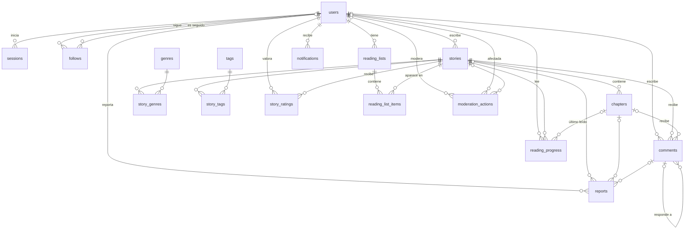
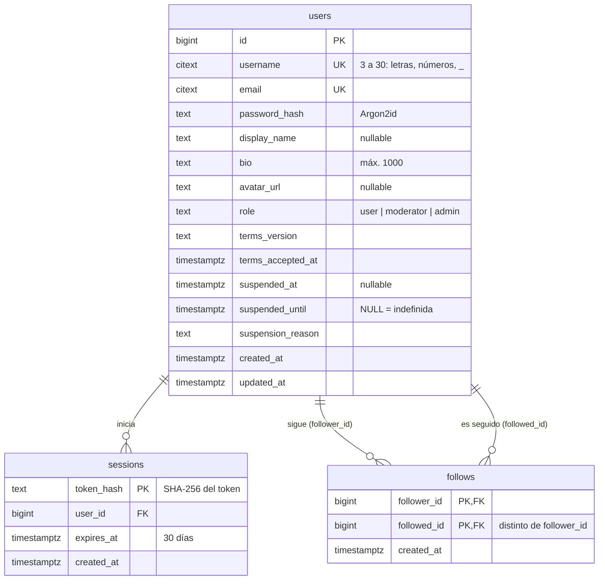
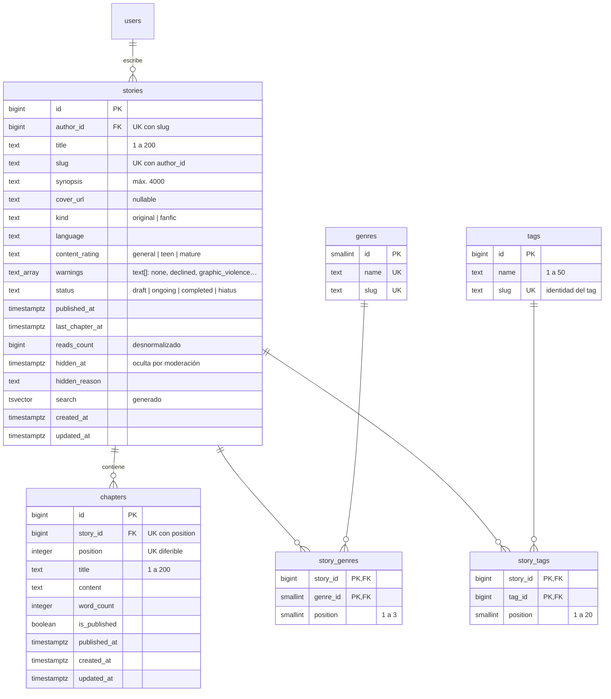
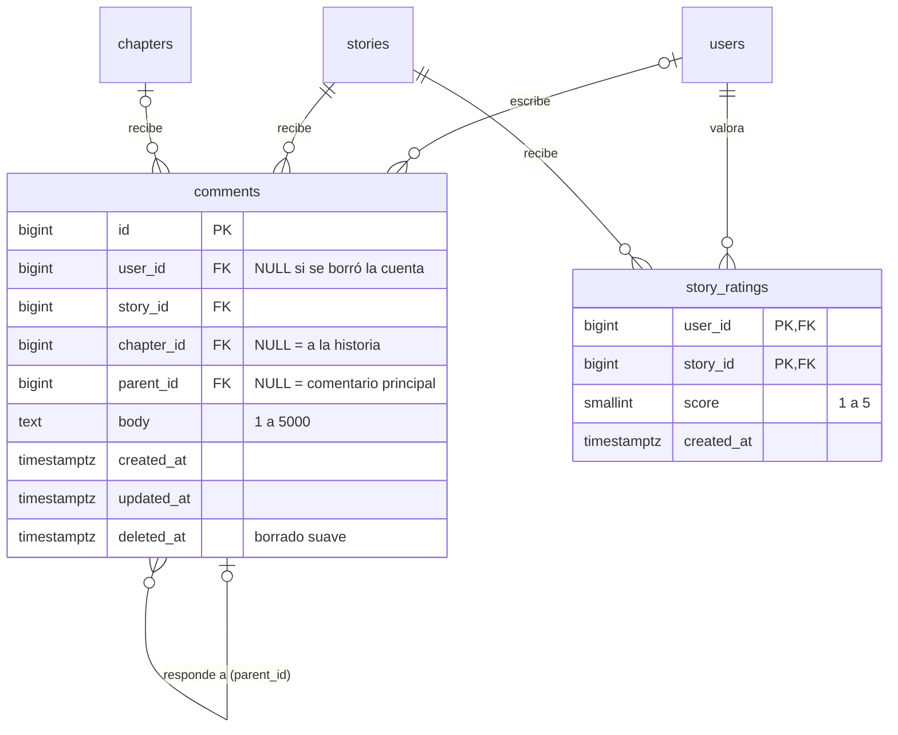
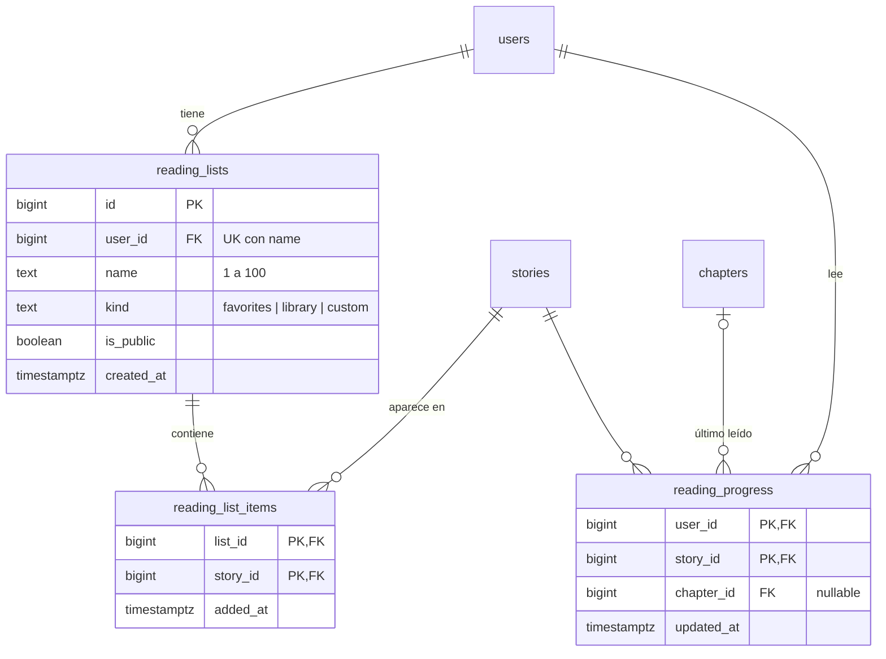
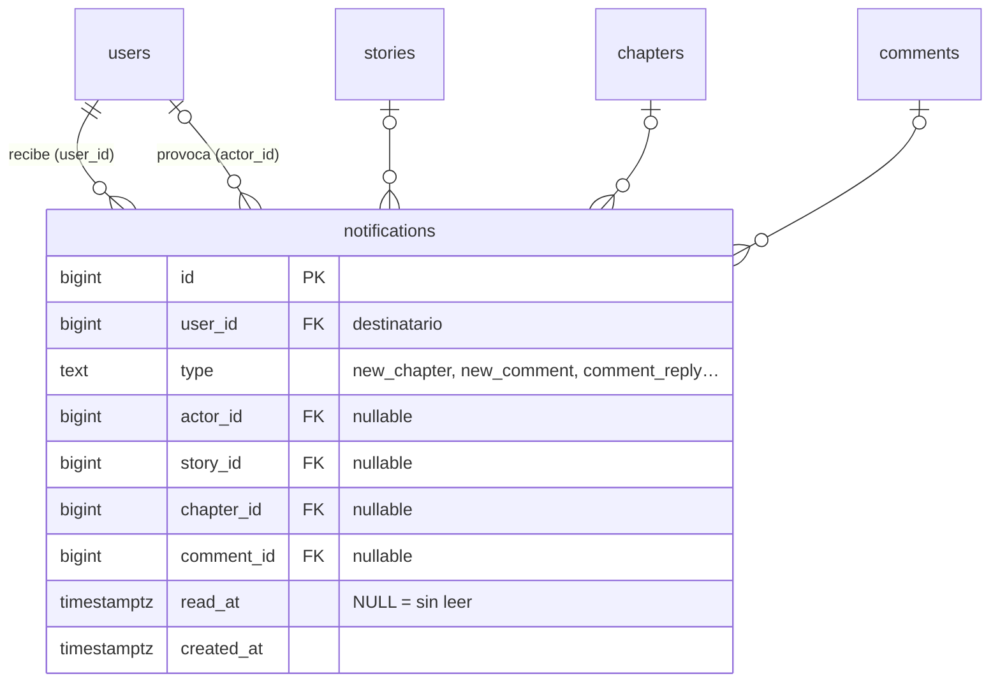
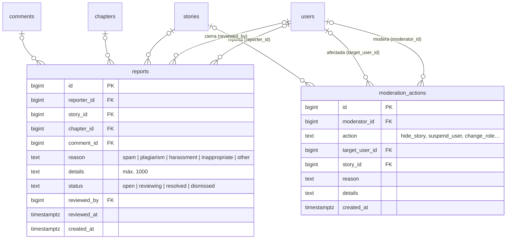

# Diagrama entidad-relación

Sale de [`db/schema.sql`](../db/schema.sql); si cambia el esquema, hay que actualizar este archivo.
Primero va una vista general solo con las relaciones, y después el detalle de cada área con sus columnas.

Notación de las relaciones (pata de gallo): `||` exactamente uno, `|o` cero o uno, `o{` cero o muchos.
Una relación `|o` significa que la clave foránea admite `NULL`.

## Estado de cada tabla

| Área | Tabla | Estado |
|---|---|---|
| Usuarios | `users`, `sessions` | En uso |
| Usuarios | `follows` | Planificada |
| Clasificación | `genres`, `tags`, `story_genres`, `story_tags` | En uso |
| Historias | `stories`, `chapters` | En uso |
| Interacción | `comments` | En uso (solo comentarios en capítulos) |
| Interacción | `story_ratings` | Planificada |
| Biblioteca | `reading_progress` | En uso (registra las lecturas) |
| Biblioteca | `reading_lists`, `reading_list_items` | Planificada |
| Notificaciones | `notifications` | Planificada |
| Moderación | `reports`, `moderation_actions` | En uso |

## Vista general

## Usuarios y sesiones

`username` y `email` son `citext` (sin distinguir mayúsculas). La suspensión está vigente si
`suspended_at` tiene valor y `suspended_until` es `NULL` (indefinida) o una fecha futura.

## Historias, capítulos y clasificación

Una historia tiene hasta 3 géneros y hasta 20 tags; `position` es el orden que eligió el autor.
`search` es un `tsvector` generado (título con más peso que la sinopsis).

## Interacción: comentarios y valoraciones

Un comentario con `chapter_id` `NULL` es un comentario a la historia (todavía no se usa). El
borrado es suave (`deleted_at`), y si se borra la cuenta, el comentario se queda sin autor.

## Biblioteca y progreso de lectura

Cada usuario tiene como máximo una lista `favorites` y una `library`; las `custom` no tienen límite.

## Notificaciones

## Moderación

Un reporte apunta al menos a una historia, un capítulo o un comentario. El registro de acciones usa
`ON DELETE SET NULL` para sobrevivir aunque se borre la historia o la cuenta.

