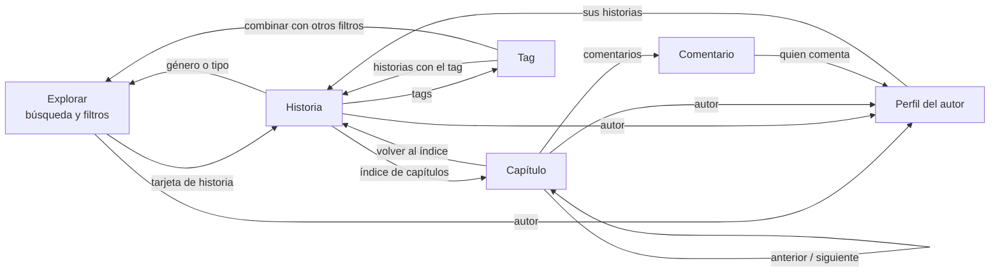

# Mapa del sitio

Sale de las rutas de [`internal/server/routes.go`](../internal/server/routes.go) y de los enlaces de las
plantillas `.templ`; si se añade una página, hay que actualizar este archivo.

Solo aparecen las páginas (rutas `GET`). Las acciones que cambian datos (`POST`: guardar, borrar,
ocultar, suspender…) se envían desde formularios de estas páginas y vuelven a alguna de ellas.

Leyenda de colores (quién puede entrar):

- **Público**: cualquiera, con o sin cuenta.
- **Con sesión**: hace falta iniciar sesión; si no, se redirige a `/login?next=…`.
- **Autor**: solo el autor de la historia (con sesión).
- **Moderación**: moderadores y administradores.

## Estructura

```mermaid
flowchart TD
    home["Inicio<br/>/"]

    subgraph cuenta["Cuenta"]
        register["Crear cuenta<br/>/register"]
        login["Iniciar sesión<br/>/login"]
        settings["Editar perfil<br/>/settings/profile"]
    end

    subgraph lectura["Lectura"]
        explore["Explorar historias<br/>/stories?q=…&genre=…&tags=…"]
        story["Historia<br/>/stories/{id}/{slug}"]
        chapter["Capítulo y comentarios<br/>/stories/{id}/{slug}/chapters/{id}"]
        tag["Tag<br/>/tags/{slug}"]
        author["Perfil del autor<br/>/users/{username}"]
    end

    subgraph comentarios["Comentarios (sin JS)"]
        commentEdit["Editar comentario<br/>/comments/{id}/edit"]
        commentDelete["Borrar comentario<br/>/comments/{id}/delete"]
    end

    subgraph escritura["Escritura"]
        myStories["Mis historias<br/>/my/stories"]
        newStory["Nueva historia<br/>/stories/new"]
        editStory["Editar historia<br/>/stories/{id}/edit"]
        deleteStory["Borrar historia<br/>/stories/{id}/delete"]
        newChapter["Nuevo capítulo<br/>/stories/{id}/chapters/new"]
        editChapter["Editar capítulo<br/>/chapters/{id}/edit"]
        deleteChapter["Borrar capítulo<br/>/chapters/{id}/delete"]
    end

    subgraph reportes["Reportes"]
        report["Reportar<br/>/reports/new?story=…&chapter=…"]
        reportSent["Reporte enviado<br/>/reports/sent"]
    end

    subgraph moderacion["Moderación"]
        queue["Cola de reportes<br/>/moderation"]
        modLog["Registro de moderación<br/>/moderation/log"]
        modStory["Moderar historia<br/>/moderation/stories/{id}"]
        modUser["Moderar cuenta<br/>/moderation/users/{username}"]
    end

    subgraph legal["Legal"]
        terms["Términos de uso<br/>/terms"]
        privacy["Privacidad<br/>/privacy"]
    end

    home --> explore
    home --> myStories
    home --> login
    home --> register
    home --> settings
    home --> queue
    home -. pie de página .-> terms
    home -. pie de página .-> privacy

    explore --> story
    story --> chapter
    story --> tag
    story --> author
    chapter --> commentEdit
    chapter --> commentDelete

    myStories --> newStory
    myStories --> editStory
    myStories --> newChapter
    story --> editStory
    story --> deleteStory
    story --> newChapter
    story --> editChapter
    story --> deleteChapter
    chapter --> editChapter

    story --> report
    chapter --> report
    report --> reportSent

    queue --> modStory
    queue --> modLog
    modStory --> modUser
    author --> modUser
    story --> modStory
    chapter --> modStory

    classDef publico fill:#d9f2e3,stroke:#3c8c5a,color:#1b3d27
    classDef sesion fill:#dbe8fb,stroke:#3d6fb6,color:#1a2f52
    classDef autor fill:#fbe3d6,stroke:#c8643b,color:#4d2412
    classDef moderacion fill:#f3dcef,stroke:#9b4f8f,color:#3f1d3a

    class home,register,login,explore,story,chapter,tag,author,terms,privacy publico
    class settings,myStories,newStory,report,reportSent,commentEdit,commentDelete sesion
    class editStory,deleteStory,newChapter,editChapter,deleteChapter autor
    class queue,modLog,modStory,modUser moderacion
```

Notas:

- La cabecera de todas las páginas enlaza a Inicio, Explorar, Escribir (`/stories/new`) y Mis historias,
  y el pie a Términos y Privacidad. No se dibujan esas flechas desde cada página para que el diagrama se lea.
- Editar y borrar un comentario tienen página propia solo para quien navega sin JavaScript; con htmx se
  hacen dentro del capítulo. Borrar un comentario lo puede hacer quien lo escribió, el autor de la historia
  o la moderación.
- `/stories/{id}` (sin slug) y `/comments/{id}` no son páginas: redirigen a la historia y al comentario
  dentro de su capítulo.
- Crear cuenta e Iniciar sesión enlazan entre sí, y Crear cuenta enlaza a Términos y Privacidad.

## Enlaces entre contenidos

El brief pide una organización hipertextual: estos son los enlaces que conectan unos contenidos con otros
mientras se lee, sin pasar por el menú.

